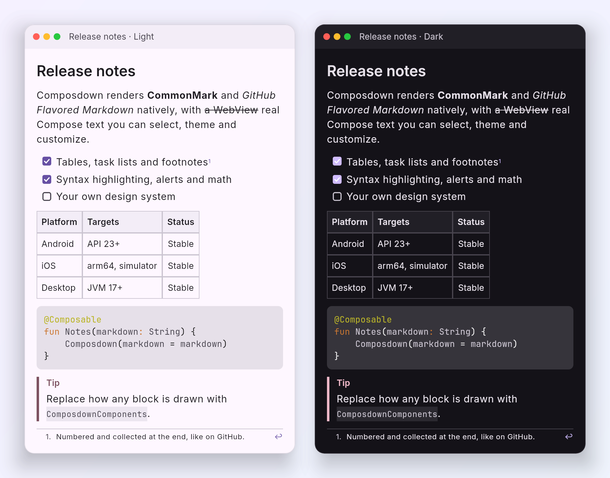
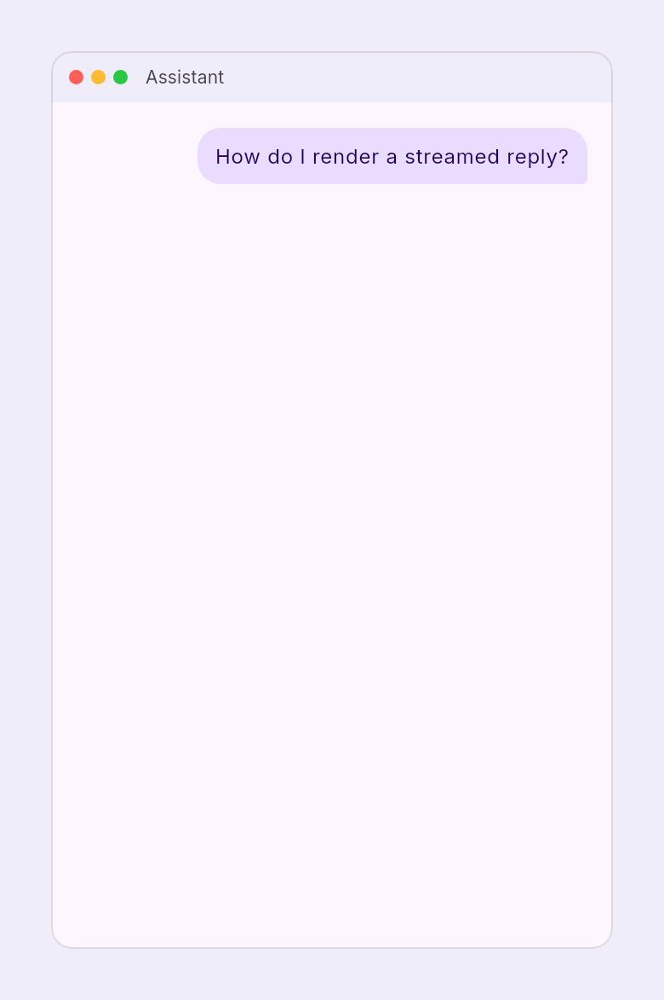
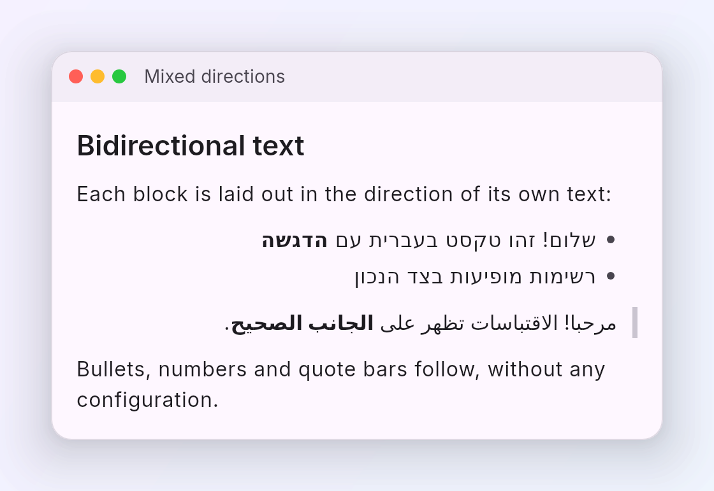
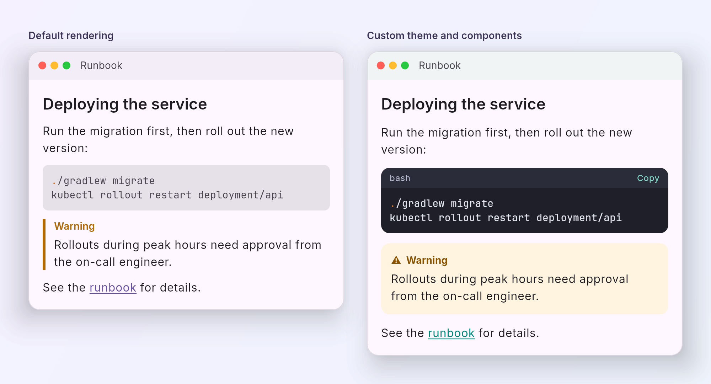

<p align="center">
  
</p>

<h1 align="center">Composdown</h1>

<p align="center">
  <strong>Complete, spec-compliant Markdown rendering for Compose Multiplatform.</strong><br>
  Native on Android, iOS and Desktop. Themeable, accessible, and fast enough for live content.
</p>

<p align="center">
  <a href="https://github.com/springmusk026/Composdown/actions/workflows/ci.yml"></a>
  <a href="LICENSE"></a>
  
  
  
  
</p>

<p align="center">
  <a href="docs/getting-started.md">Getting started</a> ·
  <a href="#documentation">Documentation</a> ·
  <a href="https://springmusk026.github.io/Composdown/">API reference</a> ·
  <a href="sample">Sample app</a> ·
  <a href="CHANGELOG.md">Changelog</a>
</p>

<p align="center">
  
</p>

Composdown parses and renders Markdown natively on Android, iOS and Desktop, from a single shared
codebase. It covers the full CommonMark specification and GitHub Flavored Markdown, renders with
Material 3, can be themed and customized down to individual elements, and stays fast and stable
whether the content is a static document, a long scrolling feed, or text that is still arriving
from a language model.

> **Status:** pre-release. The first public version will be `0.1.0`. Until then, the API may change
> between commits; breaking changes are recorded in the [changelog](CHANGELOG.md).

---

## Contents

- [Highlights](#highlights)
- [See it in action](#see-it-in-action)
- [Platform support](#platform-support)
- [Installation](#installation)
- [Usage](#usage)
- [Feature coverage](#feature-coverage)
- [Quality and verification](#quality-and-verification)
- [Performance](#performance)
- [Documentation](#documentation)
- [Comparison with other libraries](#comparison-with-other-libraries)
- [Roadmap](#roadmap)
- [Contributing](#contributing) · [Security](#security) · [License](#license)

## Highlights

- **Standards-compliant.** All 652 examples of the CommonMark 0.31.2 specification pass, together
  with the GitHub Flavored Markdown extension examples and cmark-gfm's extension tests. The suites run
  on every target platform, not only the JVM.
- **Everything GitHub renders.** Tables with alignment, task lists, strikethrough, extended autolinks,
  footnotes and alerts (`> [!NOTE]`), plus optional TeX math.
- **Native Compose rendering.** No WebView. Text is real Compose text: selectable across blocks,
  accessible to screen readers, laid out right to left where the content requires it, and themed
  with Material 3.
- **Customizable at every level.** Change colors, typography and spacing per element, or replace the
  composable for any kind of block. Images and syntax highlighting are pluggable, with ready-made
  adapters for Coil and the Highlights library.
- **Built for live content.** An incremental parser re-parses only the unfinished end of a document,
  completed blocks keep their identity so Compose skips them, and incomplete syntax is presented
  without flicker. The finished result is always identical to a one-shot parse.
- **Safe with untrusted input.** Raw HTML is never interpreted, links with unexpected schemes are not
  opened by default, remote images are restricted to HTTPS, and the parser runs in linear time on
  adversarial input.
- **Lean.** The parser is pure Kotlin with no dependencies beyond the standard library and
  kotlinx-collections-immutable. Image loading and highlighting live in optional modules.

## See it in action

<table>
  <tr>
    <td width="50%" valign="top">
      
    </td>
    <td width="50%" valign="top">
      <h4>Live content without flicker</h4>
      <p>Text that is still arriving is parsed incrementally on a background thread. Completed blocks
      are never re-parsed or recomposed, and half-written syntax such as <code>**bold</code> or an
      unfinished code fence is shown in its final form instead of flashing as raw characters.</p>
      <p>Streaming 2,000 tokens costs 6.3 ms in total, compared with 110 ms for re-parsing on every token.</p>
      <p><a href="docs/streaming.md">Live content guide →</a></p>
      <h4>Right-to-left aware</h4>
      
      <p>Every block takes the direction of its own text. <a href="docs/accessibility.md">Accessibility guide →</a></p>
    </td>
  </tr>
</table>

### Make it yours

Every color, text style and spacing value derives from your Material theme and can be overridden.
Any kind of block can be replaced with your own composable, such as a code block with a copy button
or alerts drawn as cards.

<p align="center">
  
</p>

<p align="center"><a href="docs/customization.md">Customization guide →</a></p>

## Platform support

| Platform | Targets | Minimum |
|---|---|---|
| Android | `android` | API 23 |
| iOS | `iosArm64`, `iosSimulatorArm64` | iOS 15 for the sample app |
| Desktop | `jvm` | JVM 17 |
| Web | `wasmJs` | Planned |

`composdown-core` additionally targets `iosX64`. Compose Multiplatform no longer publishes `iosX64`
artifacts, so the Compose-based modules cannot support Intel-Mac iOS simulators.

## Installation

Composdown is not yet published to Maven Central. Once `0.1.0` is released, add the modules you need
to your shared source set:

```kotlin
// build.gradle.kts
kotlin {
    sourceSets {
        commonMain.dependencies {
            implementation("io.github.springmusk026:composdown-compose:0.1.0")
            // Optional:
            implementation("io.github.springmusk026:composdown-coil:0.1.0")      // images
            implementation("io.github.springmusk026:composdown-highlight:0.1.0") // code colors
        }
    }
}
```

| Module | Purpose | Depends on |
|---|---|---|
| `composdown-core` | Markdown parser and immutable document model. No UI dependencies. | Kotlin stdlib, kotlinx-collections-immutable |
| `composdown-compose` | Compose Multiplatform renderer, theme, state holder, lazy list integration | `composdown-core`, Compose Multiplatform, Material 3 |
| `composdown-coil` | `CoilImageRenderer` for images | `composdown-compose`, Coil 3 |
| `composdown-highlight` | `HighlightsCodeHighlighter` for code blocks | `composdown-compose`, Highlights |

## Usage

### Render a document

```kotlin
@Composable
fun ArticleScreen(markdown: String) {
    Composdown(
        markdown = markdown,
        modifier = Modifier.verticalScroll(rememberScrollState()).padding(16.dp),
    )
}
```

Parsing happens when the text changes. Rendering follows the current `MaterialTheme`.

### Long content in a lazy list

For long documents or feeds of many documents, render each top-level block as a `LazyColumn` item so
only visible content is composed:

```kotlin
LazyColumn(verticalArrangement = Arrangement.spacedBy(12.dp)) {
    for (post in posts) {
        composdownItems(post.document, keyPrefix = post.id)
    }
}
```

Parse documents once, for example in a view model, with `MarkdownParser().parse(text)`.

### Content that is still arriving

For text produced incrementally, such as a response streamed from a language model, use a
`ComposdownState`. Parsing runs on a background dispatcher, and only the unfinished end of the
document is parsed again on each update:

```kotlin
val state = rememberComposdownState()

LaunchedEffect(response) {
    response.tokens.collect { token -> state.append(token) }
    state.finish()
}

Composdown(state = state)
```

### Customize

```kotlin
Composdown(
    markdown = markdown,
    theme = ComposdownDefaults.theme(
        colors = ComposdownDefaults.colors(link = Color(0xFF0B57D0)),
        spacing = ComposdownDefaults.spacing(block = 16.dp),
    ),
    components = ComposdownComponents(
        codeBlock = BlockComponent { block, modifier -> CodeBlockWithCopyButton(block, modifier) },
    ),
    imageRenderer = remember { CoilImageRenderer() },
    codeHighlighter = remember { HighlightsCodeHighlighter() },
    onLinkClick = { url -> navigator.open(url) },
)
```

### Parse without Compose

`composdown-core` produces an immutable, structurally comparable document tree that can be rendered
by any UI toolkit, inspected, or transformed:

```kotlin
val document = MarkdownParser().parse(markdown)
val headings = document.blocks.filterIsInstance<Block.Heading>().map { it.content.plainText() }
```

See the [guides](#documentation) for complete coverage of each topic.

## Feature coverage

| Feature | Syntax | Default |
|---|---|---|
| CommonMark 0.31.2 | Headings, paragraphs, emphasis, links, images, lists, quotes, code, HTML, ... | Always on |
| Tables | `\| a \| b \|` with `:---:` alignment | On |
| Task lists | `- [ ]`, `- [x]` | On |
| Strikethrough | `~text~`, `~~text~~` | On |
| Extended autolinks | `www.example.com`, `https://...`, `ftp://...`, emails | On |
| Footnotes | `text[^1]` with `[^1]: note` | On |
| Alerts | `> [!NOTE]`, `[!TIP]`, `[!IMPORTANT]`, `[!WARNING]`, `[!CAUTION]` | On in `composdown-compose`, opt-in in the parser |
| Math | `$...$`, `$$...$$`, `\(...\)`, `\[...\]`, ```` ```math ```` | Opt-in |

Extensions are selected with `MarkdownExtension`; each can be enabled or disabled independently.
Math is shown as TeX source by default; supply a `mathBlock` component to render formulas. See
[compatibility](docs/compatibility.md) for the exact behavior of every construct.

## Quality and verification

- **Specification suites.** 652 CommonMark examples and 50 GFM extension examples are generated into
  common tests and run on the JVM, on Android, and on Kotlin/Native.
- **Streaming equivalence.** Every specification example and a realistic corpus are streamed
  character by character, in random chunks and through random edits, and must finish identical to a
  one-shot parse. 400 generated documents, built from a fixed seed so any failure is reproducible, are
  checked the same way.
- **Adversarial input.** Pathological cases modeled on the reference implementation's suite (deep
  nesting, unclosed delimiters, long runs) must parse in linear time without stack overflow.
- **UI.** Compose UI tests cover semantics, link handling, extension points, streaming and
  recomposition behavior; screenshot tests cover every element in light and dark themes.
- **API stability.** Explicit API mode and binary-compatibility dumps (JVM and Kotlin/Native) make
  every public API change visible in review.
- **Static analysis.** ktlint (with Compose rules), detekt and Android Lint run on every change.

## Performance

Measured on the JVM with JMH (OpenJDK 21, 4 vCPUs). See [`benchmarks/BASELINE.md`](benchmarks/BASELINE.md).

| Scenario | Time |
|---|---|
| Parse a 73 KB document | 1.9 ms |
| Stream 2,000 tokens, document produced after every token | 6.3 ms total (about 3 µs per token) |
| The same stream, re-parsing the whole text each time | 110 ms |

The cost of a streaming update depends on the size of the unfinished block, not on the length of the
document, so it stays constant as a conversation grows.

On Android, both libraries ship Baseline Profiles so that rendering code is precompiled at install
time, and Macrobenchmarks measure startup, scrolling and streaming in the sample app. See
[Performance](docs/performance.md).

## Documentation

| Guide | |
|---|---|
| [Getting started](docs/getting-started.md) | Installation, first render, platform notes |
| [Rendering](docs/rendering.md) | Static documents, lazy lists, selection, links, images, code, math |
| [Live content](docs/streaming.md) | `ComposdownState`, view models, streaming policies, guarantees |
| [Customization](docs/customization.md) | Theme, components, image renderers, code highlighters |
| [Parser and document model](docs/parser.md) | Using `composdown-core` directly |
| [Performance](docs/performance.md) | Benchmarks, Baseline Profiles, guidance for applications |
| [Accessibility](docs/accessibility.md) | Semantics, right-to-left text, manual verification |
| [Compatibility](docs/compatibility.md) | Specification coverage, extensions, known differences |
| [Architecture](docs/architecture.md) | How parsing, incremental updates and rendering work |

The [API reference](https://springmusk026.github.io/Composdown/) is generated from the KDoc of every
public declaration and published with each release (`./gradlew dokkaGenerate` builds it locally).

A runnable [sample](sample) for Android, iOS and Desktop demonstrates every feature, including a
simulated chat that streams responses at a realistic pace.

The images in this README are rendered by Composdown itself, from
[`tools/screenshots`](tools/screenshots), and regenerated when rendering changes.

## Comparison with other libraries

Several Markdown renderers exist for Compose. The most established,
[multiplatform-markdown-renderer](https://github.com/mikepenz/multiplatform-markdown-renderer), is
mature and feature-rich and is a good choice for many applications. Composdown differs in these
respects:

| | Composdown |
|---|---|
| Parser | Written for Composdown in pure Kotlin, verified against the full CommonMark and GFM example suites on every platform |
| Incremental updates | Only the unfinished end of a document is re-parsed; completed blocks keep their instances |
| Partial syntax | Unfinished emphasis, code, links and block markers are presented without flicker |
| Extension points | Replaceable rendering per block type, pluggable images, highlighting and math |
| Untrusted content | Safe defaults for links, images and HTML; linear-time parsing |

Measured comparisons will be published with the first release.

## Roadmap

| Milestone | Scope |
|---|---|
| 0.1.0 | First release: everything described above, published for Android, iOS and Desktop |
| Next | Web (`wasmJs`) target, native TeX formula rendering, inline images inside text, published reference results from physical Android devices |

## Contributing

Contributions are welcome. [CONTRIBUTING.md](CONTRIBUTING.md) describes the development setup, the
quality gates every change must pass, and how to propose API changes. Please follow the
[Code of Conduct](CODE_OF_CONDUCT.md).

## Security

Composdown is designed to render untrusted Markdown. See [SECURITY.md](SECURITY.md) for the security
model and how to report a vulnerability privately.

## License

```
Copyright 2026 Composdown contributors

Licensed under the Apache License, Version 2.0 (the "License");
you may not use this file except in compliance with the License.
You may obtain a copy of the License at

    http://www.apache.org/licenses/LICENSE-2.0

Unless required by applicable law or agreed to in writing, software
distributed under the License is distributed on an "AS IS" BASIS,
WITHOUT WARRANTIES OR CONDITIONS OF ANY KIND, either express or implied.
See the License for the specific language governing permissions and
limitations under the License.
```
